<div align="center">


<a href="https://flight-delay-mlops.streamlit.app">

</a>

<br/>

<a href="https://flight-delay-mlops.streamlit.app"></a>


**DSE ZG529 · Data Management for Machine Learning · BITS Pilani WILP**
<br/>*Experiential Learning Assignment*

</div>

---

## 🛰️ What this is

An end-to-end pipeline that predicts whether an **Indian domestic flight will depart more than 15 minutes late**, built to show the data-management practices that turn a model into a reliable system. Each data version, feature, experiment and prediction can be **reproduced, traced and audited**.

## ⚡ The four stages

| | Stage | What it proves | Syllabus |
|:-:|---|---|---|
| 🟦 **①** | **Data versioning (DVC)** | Content-addressed datasets, lineage, diffs, bit-exact reproducibility | CS 6 · CS 9 · Lab Exp 4 |
| 🟪 **②** | **Feature store** | Offline + online stores, point-in-time joins, leakage prevention, zero training/serving skew | CS 8 · CS 11 · Lab Exp 4 |
| 🟨 **③** | **MLflow tracking & registry** | Params, metrics, artifacts, dataset lineage, versioned models, `@champion` alias | CS 12 · Lab Exp 3 |
| 🟩 **④** | **Prediction service** | Registry-resolved model + online features, REST API, per-prediction lineage | CS 5 · CS 16 · Lab Exp 4 |

## 🧬 Architecture

```mermaid
flowchart TB
    SRC(["✈️ Flight-ops extracts"]):::src --> V1

    subgraph S1["① DATA VERSIONING"]
      direction LR
      V1["v1.0 raw"] --> V2["v1.1 cleaned"] --> V3["v2.0 schema change"] --> V4["v3.0 drift"]
    end

    subgraph S2["② FEATURE STORE"]
      direction LR
      OFF[("Offline · Parquet<br/>full history")] -->|"materialize"| ON[("Online · SQLite<br/>latest values")]
    end

    subgraph S3["③ MLFLOW"]
      direction LR
      EXP["Experiments<br/>params · metrics · artifacts"] --> REG{{"Registry<br/>alias: champion"}}
    end

    subgraph S4["④ SERVING"]
      direction LR
      API[["Prediction service<br/>FastAPI · Streamlit"]]
    end

    V3 -->|"point-in-time<br/>training set"| OFF
    OFF --> EXP
    REG --> API
    ON --> API
    API --> USER(["📊 Ops dashboard"]):::src

    classDef src fill:#1A1030,stroke:#FF2BD6,stroke-width:2px,color:#FFFFFF
    classDef default fill:#0E1424,stroke:#00F0FF,stroke-width:1.5px,color:#E6F1FF
    style S1 fill:#070B14,stroke:#00F0FF,stroke-width:2px,color:#00F0FF
    style S2 fill:#070B14,stroke:#39FF88,stroke-width:2px,color:#39FF88
    style S3 fill:#070B14,stroke:#FFC300,stroke-width:2px,color:#FFC300
    style S4 fill:#070B14,stroke:#FF2BD6,stroke-width:2px,color:#FF2BD6
```



## 🗂️ Dataset versions

Synthetic but realistic Indian domestic flight operations for 2025: **8 airports, 6 carriers, ~35k flights**. The data is generated deterministically from a seed, so every version is reproducible. Delays are driven by carrier and hub-congestion effects, evening knock-on delays, weather, winter fog at north-Indian airports, and persistent airport-level disruption.

| Version | Content | Data-management event |
|:-:|---|---|
| `v1.0` | Jan–Jun 2025 raw extract | 🔴 3% duplicate rows, 4% missing weather readings |
| `v1.1` | v1.0 cleaned | 🟢 De-duplicated, weather imputed by airport median |
| `v2.0` | Jan–Sep 2025 | 🟡 New carrier **QP** + new column `aircraft_type` (schema change) |
| `v3.0` | Full year 2025 | 🟣 Winter fog season (distribution drift) |

## 📈 Key results

| Experiment | ROC-AUC | |
|---|:-:|---|
| Base features only (v2.0) | **~0.61** | baseline |
| + feature-store features, point-in-time correct | **~0.67** | ✅ honest |
| Naive same-day join, offline test | **~0.78** | ⚠️ inflated by leakage |
| Naive same-day join, in production | **~0.63** | ❌ worse than the honest model |

> [!IMPORTANT]
> The leaky model *looks* best offline but is worst in production. Point-in-time joins in the feature store are what make offline metrics trustworthy.

## 🔐 Security & robustness

| Area | Protection |
|---|---|
| Destructive actions | *Rebuild pipeline* is hidden unless an `ADMIN_PASSWORD` secret is set; checked with constant-time comparison |
| Abuse / DoS | Per-session cooldowns on every write action and a global cap on stored MLflow runs (`MAX_MLFLOW_RUNS`, default 80) |
| Injection | Data-version tags, feature-view (SQL table) names and the MLflow DB pointer are whitelisted; entity values use parameterised SQL |
| XSS | Free-text run names are sanitised (safe characters only, 60-char limit); no user text is rendered as HTML |
| REST API | Strict Pydantic schema (enumerated airports/carriers, typed `datetime`, bounded weather, unknown fields rejected), generic 503 errors with no stack traces, security headers, trusted-host check |
| Deserialisation | Models are only loaded from this app's own MLflow registry, never from user-supplied paths |
| Supply chain | Dependency versions bounded in `requirements.txt` |
| Privacy | MLflow telemetry and Streamlit usage stats disabled; error details limited to the exception type |

To enable admin actions on Streamlit Cloud: **Manage app → Settings → Secrets** and add `ADMIN_PASSWORD = "your-password"`.

## 🚀 Run it

```bash
pip install -r requirements-dev.txt
python -m src.pipeline                  # or: dvc repro
streamlit run app.py                    # interactive neon UI
uvicorn serving.api:app --port 8000     # REST API → http://localhost:8000/docs
mlflow ui --backend-store-uri sqlite:///mlflow.db
pytest -q
```

On first launch, the Streamlit app builds everything automatically in about 40 seconds.

## 🧩 Repository layout

```
app.py                  Streamlit app — one neon tab per pipeline stage
src/data_generation.py  Synthetic data + version definitions
src/versioning.py       DVC-style content-addressed versioning, checkout, diff
src/feature_store.py    Feature views, offline/online stores, point-in-time join, materialize
src/train.py            Training, MLflow tracking, leakage experiment, model registry
src/predict.py          Prediction service core with lineage
src/pipeline.py         Stage runner used by dvc.yaml
src/security.py         Input validation, sanitising, rate limits, admin check
serving/api.py          FastAPI REST service
dvc.yaml · params.yaml  DVC pipeline definition and parameters
tests/                  Reproducibility, point-in-time, security and API tests
docs/VIDEO_SCRIPT.md    1-minute script for each team member
```

## 👥 Team

| | Member | BITS ID | Owns |
|:-:|---|---|---|
| 🟦 | **Rohesen Rajkamal Maurya** | 2025NS04108 | ① Data Versioning (DVC) |
| 🟪 | **Akriti Adarsh** | 2025NS04070 | ② Feature Engineering & Feature Store |
| 🟨 | **Chelsa Sam** | 2025NS04086 | ③ Experiment Tracking & Model Registry |
| 🟩 | **Amogh J Putanikar** | 2025NS04023 | ④ Prediction Service & Lineage |

<div align="center">


</div>
